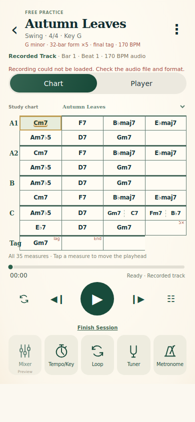
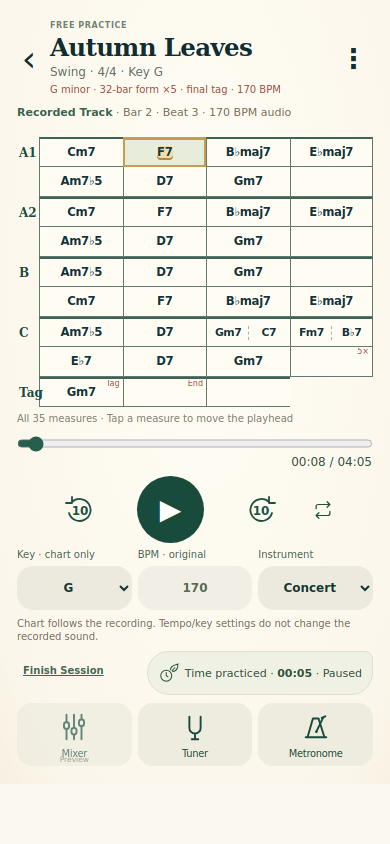
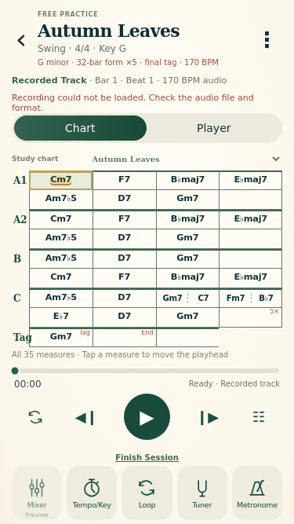
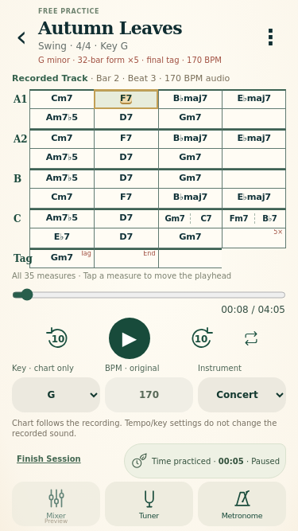

# P02 unified practice player review

Base: `class-demo-2026-10-31` at `35beaad`. Branch: `fix/practice-player-audio-controls-redesign`.

The existing shared player now opens to its chart and shows the recording timeline immediately below it. The separate Player/artwork view and duplicate controls are removed. Audio-only recordings explicitly show “No chart linked”; chart-only practice has no audio timeline.

- The scrubber and ±10-second skips seek the HTMLAudioElement. The existing recording-to-chart mapping remains unchanged.
- Whole-recording Repeat uses native media looping. Time updates and the existing media-clock poll reset chart highlighting when playback wraps. Section loops remain available for chart-only practice.
- Practice duration remains wall-clock active time, independent of audio seeking and repeat. The leaf/clock badge can be hidden without affecting tracking. Audio play/pause starts/pauses recorded-track practice; chart-only practice retains its practice start/pause control.
- Inline key and written-pitch controls transpose the chart. Recorded BPM is read-only. Labels explain that recorded pitch and speed do not change. Chart-only reference BPM remains editable.
- Mixer is disabled and marked Preview. Tuner and Metronome remain accessible in-session.
- Guided instruction/chart views, step navigation, duration goals, completion and saved Progress remain intact.

## Visual comparison

Available supplied reference: `Approved UI/P/P02 - free.png` from the attached approved UI ZIP. This preserves its ivory/evergreen palette, serif header, jazz grid, circular transport, and thin tool icons. The separate circular-arrow reference mentioned in the request was not present among this turn's attachments; the implementation uses circular arrows with an upright “10” inside.

| 390 × 844: before chart | 390 × 844: after |
| --- | --- |
|  |  |

| 375 × 667: before chart | 375 × 667: after |
| --- | --- |
|  |  |

[Removed artwork/player view, 390 × 844](screenshots/p02-recorded-audio/before/390x844-autumn-recorded-player.png) · [375 × 667](screenshots/p02-recorded-audio/before/375x667-autumn-recorded-player.png) · [Supplied approved reference](screenshots/p02-recorded-audio/reference/approved-p02-free.png)

[Chart-only 390 × 844](screenshots/p02-recorded-audio/390x844-chart-only.png) · [Chart-only 375 × 667](screenshots/p02-recorded-audio/375x667-chart-only.png) · [No-linked-chart fixture 390 × 844](screenshots/p02-recorded-audio/390x844-no-chart.png) · [375 × 667](screenshots/p02-recorded-audio/375x667-no-chart.png)

## Validation

- `npm run build`: pass. Existing bundle-size warning remains.
- `npm test`: 162 passed, 2 opt-in browser tests skipped. Mobile browser scripts run separately below.
- `node scripts/check-p02-recorded-playback.mjs`: pass at 390 × 844 and 375 × 667. Deterministic mocked HTMLMediaElement clock and native range interaction: one scrubber, dragging, immediate chord-event highlighting, measure-tap seek, ±10 clamping at zero/end, play/pause, repeat, all five chorus starts, final tag, separate elapsed time, hide/resume, pause at end, chart transposition, fixed recorded BPM/rate, exact saved duration and Progress after reload, chart-only controls, no-linked-chart fixture, no horizontal overflow.
- `node scripts/check-chart-routine-player-integration.mjs`: pass at both sizes. Custom 6/8 chart with event durations/annotations → practice → finish → save → Progress after reload; 3/4 chart created from an unfinished exercise → repeated routine steps with distinct durations/order → player after reload. Existing unit tests cover 3/4, 4/4 and 6/8 clock math and the recording arrangement.
- Original 3,971,609-byte AAC file, exact 35-box chart, 170 BPM, 5.75-second alignment, recording sequence, chart renderer and saved-session implementation are unchanged.
- Visually inspected both unified-player captures. The smaller viewport fits the complete Autumn Leaves chart and all transport/settings/tools; larger custom charts and guided lessons retain page scrolling.

## Limitations

- Chromium here cannot decode AAC. Mocked media tests validate controls and synchronization logic, not audible playback, native decoder behavior or real-device gapless looping. Product owner previously confirmed real iPhone playback; no new device playback claim is made.
- The no-linked-chart capture uses a test-only catalog fixture because the current catalog contains only linked Autumn Leaves.
- No audio time stretching/pitch processing or stems added. Mixer remains Preview.
- Product-owner visual acceptance remains pending.

No merge or deployment requested or performed. `web/vercel.json` disables automatic Git deployments specifically for this fix branch, leaving other branch settings unchanged (Vercel `git.deploymentEnabled`).
