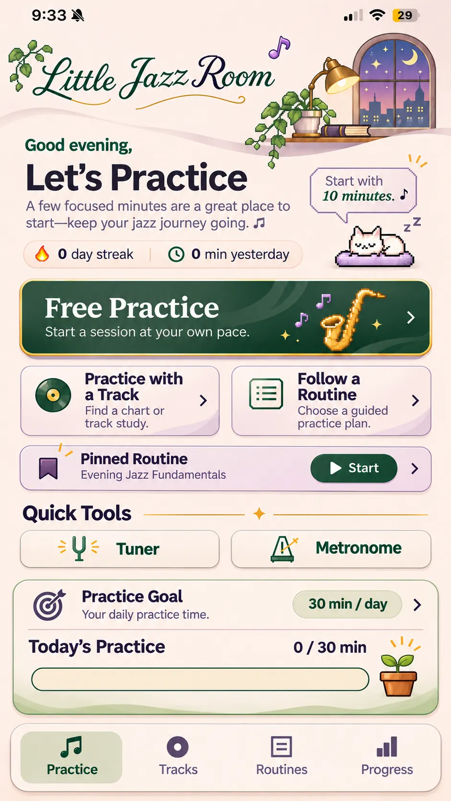

# Practice Hub: Approved visual reference (November 8, 2026)

**Current branding decision (November 9, 2026):** The Practice home masthead and page title must read **Little Jazz**, not “Little Jazz Room.” This newer instruction supersedes the name shown in the reference image. Preserve the window, botanical accents and layout while using the new text wordmark. Pixelify Sans is approved for prominent Practice headings/actions; retain readable sans-serif instructional text. The Free Practice card should show one pixel note rather than clustered sax/notes/sparkles. Secondary card corner waves and progress-panel waves are removed.\n\n**Visual authority:** [approved-practice-home-2026-11-08.webp](./approved-practice-home-2026-11-08.webp), 941 × 1670. This is the full-screen reference chosen by the owner, not a deployed-app screenshot. The existing working application is authoritative for functionality and actual dynamic state.

## Scope
This reference governs the Practice landing page only (`PracticeHubPage.tsx`, `PracticeSuaveStudio.css`, `PracticeApprovedFinish.css` and its visible navigation dock). It does **not** authorize changes to the player, recorded audio, chart grid, session data, routes, cat selection, or unrelated pages.

## Must match visually
- Warm ivory/peach background; elegant script **Little Jazz Room** header with botanicals, small purple note, brass lamp, night window and curved shelf.
- Forest-green greeting, prominent dark **Let's Practice** headline, short motivational copy, stat pill with the **user-approved fire streak icon** and clock.
- Small speech bubble and **approved sleeping pixel cat**, obeying the existing Cat Mode toggle and selected companion.
- Full-width forest-green **Free Practice** primary card with subtle decorative waves, gold saxophone and lilac music-note artwork, gold border.
- Two balanced light, lavender-outlined cards side by side: **Practice with a Track** and **Follow a Routine**.
- A compact **Pinned Routine** card between practice actions and Quick Tools; if no routine is pinned, show a working **Choose** action, not a fake example routine.
- **Quick Tools** title with thin gold divider/sparkle; equal-sized **Tuner** and **Metronome** buttons.
- A pale progress panel with **Practice Goal** (tap to edit minutes/day) and **Today's Practice** (actual elapsed minutes against that goal); a regular **solid green fill bar**, **never** liquid/water/potion; a small potted pixel plant that grows as the goal progresses.
- A floating rounded four-tab mobile nav: Practice / Tracks / Routines / Progress, with active Practice indication.

## Dynamic content vs mockup
The sample text `0 day streak`, `0 min yesterday`, `0 / 30 min`, and `Evening Jazz Fundamentals` are **illustrative only**. Use real sessions, actual pinned routine, and configured user goal. The example illustrates layout, not seeded user data. A "Practice Again" action may appear when the user actually has a recent session. Preserve working buttons.

## UI engineering constraints
- Mobile first, especially 375 × 667 and 390 × 844. Content may scroll on short devices. Do not shrink tap targets or fonts to force the entire mockup onto one screen.
- Light theme should most closely match the attached image. Dark mode must remain readable without light-only color overrides breaking accessibility.
- Use exact approved images from PR #84 where suitable and reuse the approved cats; do not regenerate substitute art. Preserve crisp pixel treatment.
- No new animations, audio changes, new features, or unapproved parallel redesigns.
- Verify image paths, no clipped cards/labels, responsive positioning, goal editing, routine selection, Cat Mode, and bottom-nav behavior.
- Do not merge into `class-demo-2026-10-31`. Continue work in PR #87 and get owner approval before merging to `integration/clean-pixel-themes`.

## Reference implementation
- `web/src/pages/PracticeHubPage.tsx`: functional page and real state
- `web/src/pages/PracticeSuaveStudio.css`: layout and shared visual treatment
- `web/src/pages/PracticeApprovedFinish.css`: more recent screenshot-fidelity adjustments
- `web/public/visuals/new-assets/2026-11-07-sharp-pixel/`: incoming approved candidate artwork
